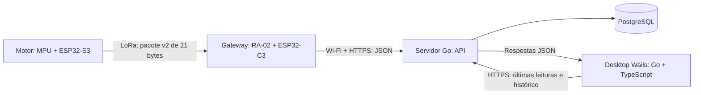

# Arquitetura da aplicação desktop e comunicação pela internet

Proposta de implementação — 11/10/2026.

Stack escolhida pelo usuário: **Wails, Go e TypeScript**, com aplicação desktop multiplataforma. O enlace S3 → LoRa → C3 já recebeu pacotes válidos em bancada. A base desktop e a API Go/PostgreSQL já foram implementadas. O firmware C3 agora inclui Wi-Fi/HTTPS, fila e heartbeat conforme o contrato v1; faltam configuração e validação física do percurso completo, além do cliente de API no desktop. Ver [configuração do C3](../../../src/receiver/INTERNET.md).

## Fluxo principal



O servidor permanece disponível para receber leituras mesmo com o desktop fechado. O gateway e o desktop iniciam conexões de saída com ele; o computador do usuário não precisa expor uma porta pública nem permanecer ligado para que as medições sejam armazenadas.

Primeira versão: gateway publica por HTTPS e desktop consulta a API a cada 2 segundos enquanto a tela de monitoramento está aberta. Esse intervalo é uma proposta para a bancada, onde há uma leitura aproximadamente a cada 11 segundos. Consultas de histórico são paginadas e feitas sob demanda. WebSocket pode substituir as consultas periódicas depois, mantendo HTTP para carregar o histórico e recuperar eventos após reconexão.

## Responsabilidades

| Componente | Responsabilidade |
|---|---|
| S3 | Coletar vibração, calcular indicadores e transmitir o pacote LoRa existente |
| C3 | Validar pacote, registrar metadados de recepção, enfileirar leitura, conectar ao Wi-Fi e enviar ao servidor |
| API Go | Autenticar gateway/usuário, validar contrato, persistir, evitar duplicação por reenvio e servir consultas |
| PostgreSQL | Guardar cadastro de motores, dispositivos, gateways, medições e eventos |
| Go do Wails | Cliente da API, sessão do usuário, atualização periódica, cancelamento de requisições e exportação |
| TypeScript | Telas, gráficos, filtros e apresentação dos estados recebidos do Go |

O código Go do desktop chama a API por um cliente HTTP com timeout e contexto. A interface chama métodos Go pelos bindings do Wails. Requisições não bloqueiam a interface; a rotina de atualização é cancelada quando a tela ou aplicação fecha. O servidor é um executável separado do desktop.

## Tecnologias propostas

- **Desktop:** Wails + Go + TypeScript; escolha do framework de interface e versão principal do Wails na preparação do projeto.
- **Servidor:** Go com `net/http`, validação explícita e camadas pequenas de serviço/repositório.
- **Persistência central:** PostgreSQL, com migrações SQL versionadas.
- **Gateway:** manter Arduino/PlatformIO e acrescentar Wi-Fi, cliente HTTPS e fila; sem migrar o firmware inteiro para outro SDK.
- **Desenvolvimento:** servidor e banco locais para testes de contrato; posteriormente, endpoint HTTPS público para validar o percurso pela internet.

## Contrato gateway → servidor

O modelo detalhado, schemas JSON e fixtures para alinhar C3 e API Go estão no [contrato gateway v1](../../contracts/gateway-v1/README.md).

O pacote LoRa continua v2/21 bytes. O C3 acrescenta metadados ao converter a leitura para JSON. O contrato HTTP tem sua própria versão, independente da versão LoRa.

Campos da requisição:

| Campo | Tipo | Origem ou significado |
|---|---|---|
| `schema_version` | Inteiro | Versão do contrato HTTP |
| `gateway_id` | String | Identidade cadastrada do gateway |
| `gateway_session_id` | String | Identificador gerado a cada boot do gateway |
| `upload_uptime_ms` | Inteiro | Tempo desde o boot no momento do envio |
| `readings` | Array | Leituras validadas pelo gateway |

Campos de cada leitura:

| Campo | Tipo | Origem ou significado |
|---|---|---|
| `event_seq` | Inteiro | Sequência de recepção dentro da sessão do gateway |
| `gateway_rx_uptime_ms` | Inteiro | Tempo desde o boot no momento da recepção |
| `gateway_received_at` | Data/hora UTC ou `null` | Horário de recepção, quando sincronizado |
| `packet_version` | Inteiro | Versão do pacote LoRa recebido |
| `device_id` | String hexadecimal | Identificador do dispositivo recebido no pacote |
| `device_sequence` | Inteiro | Contador recebido no pacote |
| `state` | String | Classificação recebida do dispositivo |
| `diag_code` | Inteiro | Código de diagnóstico recebido |
| `rms_g` | Número ou `null` | RMS de aceleração em g |
| `temperature_c` | Número ou `null` | Temperatura medida em graus Celsius |
| `rssi_dbm` | Número | RSSI do pacote recebido, em dBm |
| `snr_db` | Número | SNR do pacote recebido, em dB |
| `packet_crc16` | Inteiro | CRC recebido no pacote LoRa |

Pacotes sem CRC válido não entram no caminho de medições; sua rejeição aparece nos contadores do gateway. A API valida tipos, versão, estados conhecidos, números finitos e limites de lote; não confia apenas na validação do C3.

### Valores ausentes e limites do pacote atual

- Converter NaN para `null` no JSON, sem substituir por zero.
- `UNKNOWN` significa classificação indisponível; não equivale a motor normal.
- `diag=OK` significa ausência de erro reportado no ciclo; não valida o modelo para o motor.
- O pacote atual transmite RMS e temperatura. Curtose, fator de crista, frequência dominante e forma de onda **não chegam ao desktop**. Mostrar esses dados exigirá uma evolução explícita do protocolo LoRa.
- RMS em g é aceleração; não apresentar como velocidade em mm/s ou comparar diretamente com limites de velocidade.

### Identidade, sequência e horário

`device_id` identifica o sensor e é associado a um motor no cadastro. Dispositivos ainda não cadastrados aparecem como “não associados”, preservando as leituras para posterior associação.

`device_sequence` é o `boot_count` do pacote atual. No ambiente de bancada ele incrementa por ciclo e pode voltar a 1 após reset. Por isso, **não usar `(device_id, device_sequence)` como chave única permanente**.

O gateway tem identidade cadastrada e uma sessão nova a cada boot, gerada com identificador aleatório. `event_seq` incrementa por pacote validado, dentro dessa sessão. A chave `(gateway_id, gateway_session_id, event_seq)` identifica o evento de recepção e permanece igual em todas as tentativas de envio desse evento.

O servidor registra `ingested_at` em UTC. O C3 sincroniza relógio por NTP quando disponível; `gateway_received_at` fica `null` se o relógio não era confiável na recepção. A tela distingue horário de recepção no gateway de horário de chegada ao servidor: nenhum deles deve ser rotulado como horário exato de aquisição no motor.

`upload_uptime_ms - gateway_rx_uptime_ms` informa o atraso na fila na mesma sessão. Esse atraso evita que uma leitura antiga reenviada após queda da internet seja apresentada como medição fresca. Timestamps monotônicos devem usar contador de 64 bits e não atravessar resets.

## Entrega e reconexão no C3

1. A tarefa de rádio valida a leitura e a coloca em uma fila limitada.
2. Uma tarefa de rede consome a fila e envia lotes de até 8 leituras por HTTPS, com timeout e retentativas espaçadas.
3. O servidor confirma os eventos somente depois de persistir a transação.
4. O C3 remove apenas os eventos confirmados. Se uma resposta se perder, envia os mesmos identificadores novamente; a API reconhece duplicatas sem criar novas medições.

O acesso SPI fica restrito à tarefa do rádio. Wi-Fi, TLS e requisições HTTP não rodam dentro da ISR nem bloqueiam o loop de recepção. O C3 tem um núcleo; separar tarefas exige verificar latência, memória e watchdog com rádio e internet ativos simultaneamente.

Proposta inicial: fila em RAM de 64 leituras, com contador de descartes e ocupação no heartbeat. Ao encher, descartar a leitura mais antiga e registrar a perda. A capacidade é uma hipótese de implementação, sujeita à medição de RAM com TLS. A aproximadamente 11 s por sensor, 64 leituras cobrem cerca de 12 minutos para um sensor, mas só cerca de 70 segundos para dez sensores nesse ritmo. Reset perde a fila em RAM. Persistência em flash para interrupções longas será uma etapa posterior, com orçamento de desgaste e espaço.

A confirmação HTTP cobre **gateway → servidor**. Ela não cria confirmação ou retransmissão no trecho **S3 → gateway**, que continua sendo LoRa sem ACK.

## API inicial

| Método e caminho | Uso |
|---|---|
| `POST /api/v1/ingest/readings` | Receber lote e retornar eventos confirmados/duplicados |
| `POST /api/v1/ingest/heartbeat` | Receber sessão, uptime, ocupação da fila e contadores do gateway |
| `POST /api/v1/auth/login` | Iniciar sessão do usuário do desktop |
| `GET /api/v1/motors` | Listar motores e últimas leituras disponíveis |
| `POST /api/v1/motors` | Cadastrar motor e vincular dispositivo |
| `GET /api/v1/motors/{id}/readings` | Consultar histórico por período e cursor, com limite |
| `GET /api/v1/gateways` | Consultar última atividade e saúde dos gateways |
| `GET /api/v1/events` | Consultar eventos técnicos e alertas registrados |

O gateway usa credencial própria com permissão apenas de ingestão; a API confere que `gateway_id` corresponde à credencial. O desktop usa sessão de usuário com permissões de consulta/cadastro. HTTPS com validação de certificado é requisito do percurso pela internet. Credenciais ficam fora do repositório e dos logs; nenhuma credencial de banco vai no C3 ou no desktop.

## Modelo de dados

- **Motor:** identificador interno, nome, localização, dispositivo associado e intervalo esperado de leitura.
- **Dispositivo:** ID LoRa, associação ao motor, perfil conhecido e observações de validação.
- **Gateway:** identidade, local, sessão atual, último heartbeat e contadores.
- **Medição:** identidade do evento, dispositivo, sequência do dispositivo, horários e atraso de fila, RMS, temperatura, estado, diagnóstico, RSSI e SNR.
- **Evento:** perda observada de sequência, reset aparente, desconexão, rejeições e alertas de estado.
- **Usuário:** credenciais protegidas e permissões para acesso à API.

Guardar os dados de recepção mesmo quando houver campos ausentes; gráficos pulam valores `null` e indicam lacunas. Índice de histórico por dispositivo/tempo e chave única da identidade de evento. O MVP trabalha com um gateway por local; deduplicar recepções do mesmo pacote em múltiplos gateways exige decisão adicional e não é resolvido pela chave de evento acima.

## Telas do desktop

1. **Conexão e acesso:** endereço do servidor, login e estado da conexão.
2. **Visão dos motores:** nome, última leitura, RMS, temperatura disponível, diagnóstico e idade da medição.
3. **Detalhe do motor:** gráfico de RMS por período, histórico, sequência e qualidade do enlace.
4. **Gateways:** última atividade, falhas SPI, rejeições e fila pendente, quando esses contadores forem enviados.
5. **Cadastro:** associação dispositivo → motor e intervalo esperado.
6. **Exportação:** CSV de um período, com unidades, horário UTC e campos ausentes explícitos.

Manter separados: **conexão desktop → API**, **conexão gateway → API**, **atualidade das leituras do sensor** e **classificação do motor**. API inacessível não significa motor defeituoso; gateway online não garante chegada dos sensores; classificação desconhecida não significa normal.

Proposta de ausência de leitura: três intervalos esperados mais uma margem configurável, usando idade estimada da recepção e atraso na fila. Os intervalos de bancada (~11 s) e de campo (12 minutos mais jitter) precisam de configurações distintas. Reinício ou lacuna de sequência vira evento técnico, sem afirmar perda exata quando não há sessão do sensor no pacote atual.

## Organização proposta no repositório

```text
apps/
  desktop/                # Wails, Go e frontend TypeScript
  server/                 # Executável Go da API
packages/
  contracts/              # DTOs Go e exemplos de contrato HTTP
deploy/
  migrations/             # Migrações SQL
  compose.yaml            # Ambiente local de API + PostgreSQL
src/receiver/             # Firmware C3: rádio + fila + transporte HTTPS
```

Servidor e desktop importam DTOs Go compartilhados. O frontend usa bindings gerados pelo Wails; testes de contrato verificam o JSON emitido pelo C3. Dependências Go/TypeScript ficam separadas do projeto Python de treinamento já existente.

## Etapas e critérios de aceite

1. **Contrato e API:** fixture baseada em pacote v2 real; persistência; autenticação; reenvio idempotente; `null` e `UNKNOWN` preservados.
2. **Desktop:** cadastro, últimas leituras, histórico e exportação com dados simulados pela API; interface responsiva ao desconectar o servidor.
3. **Gateway Wi-Fi:** envio HTTPS, fila, confirmação e reconexão, mantendo os logs USB de diagnóstico.
4. **Integração local:** leitura real S3 → C3 → API → banco → desktop, com desktop fechado durante parte da coleta.
5. **Integração pela internet:** endpoint público HTTPS, C3 em Wi-Fi e desktop acessando de outra rede.
6. **Ensaios:** dez IDs simulados, carga compatível com o intervalo escolhido, queda de Wi-Fi/API, resposta perdida, reset e fila cheia; medir entrega, latência e descartes.
7. **Distribuição:** build e instalação do Wails nos sistemas alvo, preservando versão e configuração do endpoint.

A camada de internet não corrige as falhas SPI observadas anteriormente. Monitorar sua recorrência e medir a recepção com Wi-Fi/TLS ativos fazem parte do aceite da integração.

## Fontes técnicas consultadas

- [Wails: arquitetura e bindings Go/JavaScript](https://wails.io/docs/howdoesitwork/).
- [Wails: suporte e funcionalidades](https://wails.io/docs/introduction/).
- [Go: cliente e servidor HTTP](https://pkg.go.dev/net/http).
- [Espressif: cliente HTTP/HTTPS no ESP32-C3](https://docs.espressif.com/projects/esp-idf/en/stable/esp32c3/api-reference/protocols/esp_http_client.html). Referência de capacidades do chip/SDK; o projeto atual usa Arduino e sua integração será feita sem mudança de framework.
